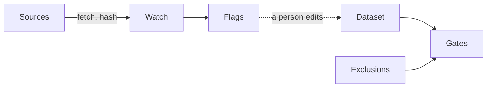
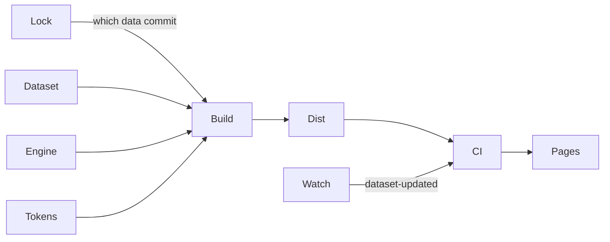
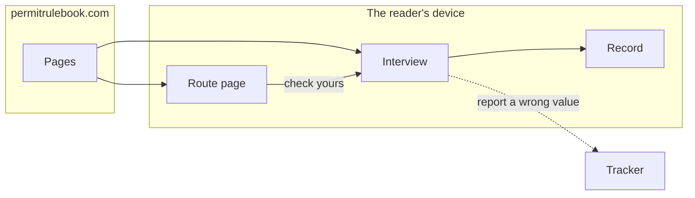

# ARCHITECTURE — Permit Rulebook (as of v1, public and announced 2026-09-09)

Updated at every slice exit. Three diagrams, one question each: where the facts
come from, how they become a site, where the reader's answers stay. Labels are
names; what each name means is in the list below the diagrams.

## 1 · Data flow — where the facts come from

## 2 · Pipeline — how the facts become a site

## 3 · Trust boundary — where the answers stay

Nothing crosses the boundary from the device outward except a reader's own
click on the tracker link. Answers never leave the device.

## The names

**Diagram 1 — permit-rulebook-data** (sibling repository; data CC BY 4.0, code MIT)

- **Sources** — the official pages and PDFs: ZAV, BOE, UGE, IND,
  service-public.gouv.fr, europa.eu, efta.int, buzer.
- **Watch** — the daily re-read (`src/watch`, GitHub Actions): strategies
  html, pdf-text (embedded-font text layer, bytes hash beside words hash) and
  link liveness; slices bind each page to its operative text; glyph
  corrections are declared data; `human_tier: 2` since 2026-09-10 (two sources a browser reads and this fetcher cannot — see the glossary); runs daily in GitHub
  Actions and, after its state is pushed, files an issue (`source-change`) per
  flag this run created or changed; a flag still open on
  the second UTC morning after it was raised turns the run red and is named
  in one issue the run keeps, `overdue flags` (#62). A red run on master keeps
  `watch run failed`, and the first green one closes it (#117). Every kept
  issue is decided in one module, `kept-issue`, and carried to the tracker by
  one CLI, built on its own so a broken build cannot silence it, that runs
  `gh` with no shell (#117). Two readers, a
  fetcher and a browser (Chrome over its own protocol), and the coverage gate
  ask one module, `trust-line`, where the watch may go: the entry address, a
  redirect target, every address a name resolves to (the fetcher's; a name
  Chrome resolves for itself is the stated gap) and the page a reader lands
  on. It imports only the failure wording; the fetcher keeps only HTTP (#104).
  What a finished run says (its
  flags, its log lines and its exit code) is decided in one module, `run-says`;
  the CLI only reads, prints and writes (#72). It audits every installed
  dependency first; a known advisory at high or above turns the run red at its
  end and stops none of its reading (#24).
- **Flags** — one file per change, with the page's *excerpt* in a fenced code
  block so nothing in it acts on the issue, and every line around it ours
  (#72); walked by a person, who edits the dataset or records what was found,
  within two days.
- **Dataset** — `data/dataset.json`: 29 routes in 4 countries, 23 of them
  asked about and 6 quoted only; every numeric value with its source URL,
  verbatim quote, retrieval date and append-only history; per route its
  statements (preconditions and caveats in the source's words), its readings
  (ours, declared) and a scope value with the limbs it does not ask. A
  question whose options are rungs of one amount is marked `ordered`; a
  criterion with paths and each path carry a label; a question names a route
  only through a `{route:<id>}` slot, filled with the route's `what_it_is`
  (#151). A path answer someone else arranges (a transfer, a hosting
  agreement) is marked `is_arranged`, and only the path question may carry
  the mark (schema 0.8.3, #167). Beside it `data/countries.json` (199 passport issuers, labels,
  aliases, the article a name takes; `classes.eu_eea_ch` is a rule with four
  sourced legs; and 11 territories, none a row, each with the passport its
  people hold and an official sentence that says so) and
  `schema/ruleset.schema.json`, the public contract.
- **Reader's words from the data** — the data package composes the words the
  site prints from the dataset: a country's name with its article, at a
  sentence's start and as a possessive; the scope line in two forms (where
  the reader has answered, "checked against your answers"; where not, "the
  checker asks about it"); a `{place}` filled "in <country>" or "in the
  country you move to"; and which kind of host a source is on, authority or
  consolidated text (#151). The site holds the labels; the package holds the
  facts.
- **Exclusions** — `data/exclusions.md`: what was researched and left out, by
  route, as prose plus a fenced machine twin.
- **Gates** — `npm run check`: schema and semantic validation · watch coverage
  both ways · quote fidelity (every shipped quote found in its snapshot) ·
  prose provenance (every renderable sentence is authority, ours or label,
  keyed on the declared kind) · every route and notice source, and every
  learn link, on an https host on the authority list or the
  consolidated-text list · labels on paths · words on an ordered range ·
  route names only in slots · each territory's passport on the list with an
  https source (#151) · the arranged mark only on the path question (#167). A failing gate fails the build downstream.
  The data repository runs them on every push to master, every pull request
  and after every watch run (`check.yml`); a red check after a watch run keeps
  `check failed on master`, and the next green one closes it (#117).

**Diagram 2 — permit-rulebook** (this repository; MIT)

- **Engine** — pure functions in the data package: eligibility by
  eq/in/gte/points/any, band edges = thresholds, deciding path,
  still-reachable, points as the best row an answer satisfies, questions by
  information gain, provable single-step unlocks, notices; property tests over
  thousands of generated profiles. A disjunction is judged path by path in its
  own module (`src/disjunction.ts`): it is a hard fail only when no path is
  open, every open path asks its questions, and when every path failed the
  deciding path is the nearest gap or else the open path with the fewest unmet
  rules. `reckonAskingRoutes` names, from the same walk as the asking rule,
  the routes a question is asked for and the open ones; `questions-do-work`
  checks, per destination and per rung, that an answer moves some route's
  decision (#133). `isStepGated` decides which routes wait on a step;
  `routesAJobOfferFrees` counts, per country, the routes a job offer would free
  for a reader with none, the job offer itself decided once by
  `findJobOfferAnswer` (#179); a gap is said once, exact and with its period, and a
  band open at the bottom names the line it is under (#167). The package also
  gives the site the dataset's own small lookups, each written once:
  `periodOf` (the period a field's amount is stated per),
  `ThresholdCriterion` and `thresholdsUnder` (every threshold under a
  criterion) (#299).
- **Tokens** — `tokens.css` (the design system) and `identity.css` (the
  identity pair: the tilted PR stamp over the read-date stamp, and the body
  and column every page lays out in; one source, inlined by the frame, linked
  by the interview).
- **Frame** — what every page wears around its own content: the head (the
  CSP, the icon links, the stylesheet), the header, the footer and the menu.
  One deep module, `src/lib/frame/` (#299). Its entry, `framed-page.ts`,
  draws the six pages built as strings (route, country, data, feedback, 404,
  status) through `framedPageHtml`, a page handing over only what differs:
  its title, preview lines, own head lines, own style rules, place and
  content. It gives the interview its pieces through `interviewFrameOf`. It
  marks the header item for the page it draws, and imports no page. Each
  page's own style rules sit beside its code, in a `.css` file read raw.
- **Build** — Astro, `base` derived from `SITE_URL`, the site's address, which
  is one literal line in `pages.yml`: the deploy reads no repository variable
  (#110). An invalid dataset breaks
  the build; the social card is rendered from the dataset's own facts with a
  sidecar that makes a stale card fail CI.
- **Dist** — 38 pages (the interview, `/data/`, `/feedback/`, the status
  page, the 404, 4 country pages, 29 route pages generated from the dataset,
  never typed) plus 29 route JSON endpoints, the dataset and the countries as
  JSON, the sitemap, favicons, the social card.
- **CI** — `pages.yml`: both repositories checked out, data gates, build,
  tests with a real browser over `dist/`, the lint, asset truth, base-path
  check, tap targets at 390 px, the carry, then deploy. The lint
  (`eslint.config.mjs`) loads Roadkeeper's preset from `roadkeeper-lint/`, which holds
  the limits, 400 lines a file and 40 a function with every line counted. The
  files over 400 lines are Ceilings in `docs/roadkeeper/ceilings.json`, each held
  to its count until within 400; every other existing breach is a Suppression
  in `eslint-suppressions.json`, whose count per file and rule cannot grow.
  The issues that pay them off carry the deadline on their milestones (#149).
  The browser harness is the deep module `scripts/browser/`, and its entry,
  `browser.mjs`, is the one way in. Every browser case, deploy job and
  real-use check opens the site through `walkSite`, the browser walk: the
  built site served for it, or a live site's root address, at `DESK` or
  `PHONE`, in a fresh profile. It returns the walker's result, the layout
  shifts of the page it ends on (#269's first-input rule, read in
  `layout-shifts/`) and the pages' errors, each with its address, the first
  100 kept. It fails when a page it draws is not the screen's width, and on
  the pages' errors unless the caller expects them. Beside it the entry
  offers `chromePath` and `serve`, kept for the server's own HTTP tests
  (#245): `serve` serves only what is inside its folder, so an escaped `../`
  or a link leading out is not found and a path it cannot decode is a bad
  request, and it can send a page's HTML in two pieces to test a paint
  mid-parse (#230). Inside, the page a walk hands over waits on what it
  reads, never a time: the page drawn, the page at rest (no animation, no
  smooth scroll going, no request in flight), a new document drawn, or a
  condition, with one 15 s backstop (`tab/`); the lint refuses a sleep in a
  test. A click or an Enter returns once the page has reported its first
  input, or another document stands: Chrome reports that input only once its
  frame is presented, after the shifts the measure reads (#269).
  `BROWSER_CPU_SLOWDOWN` slows every tab, and what a walk opens is closed
  however the process leaves (`exit-register/`).
  Each command under `scripts/` is three files, one level each: the job
  (`smoke.mjs`, `infrastructure`) does the work and returns what it found, its
  CLI (`cli-smoke.mjs`, `presentation`) reads the arguments and words the
  result, and its entry (`main-smoke.mjs`, `main`) wires the two and is what
  `package.json` runs. The dev server knows the server it started is this
  project's by `/countries.json`, and reaches no screen word (#247).
  The carry (`scripts/carry-assets`)
  copies the live generation's assets into `dist/`, only from the site's own
  address and only bytes the previous build's digest list attests; it is a
  deep module whose entry, the flow, is given the live site, the build
  directory and the clock as ports. Its domain parts are private
  (`generation/`, `outcome/`, the ceilings in `live-deploy/`); its adapters
  and its log wording sit beside the command that wires them, and it never
  fails the deploy (#110, #199). Beside the build, the audit job reads the
  site's lockfile: an advisory reddens the run, never holds the deploy; only
  `report` waits on it, and runs whatever its result. `report` runs last, on
  a scheduled or dispatched run's first attempt, after the build, the deploy,
  the pin and the audit: a red keeps one issue, `deploy run failed`, and the
  first green closes it, through the data package's kept-issue CLI built from
  the commit `data.lock` names (#117). Both workflows run on a named image,
  `ubuntu-26.04`, never `-latest` (#24).
- **Pages** — GitHub Pages at the custom domain, HTTPS enforced; static files
  only; the accepted cost is no response headers of our own.

**Diagram 3 — the reader**

- **Route page** — rules in interview order, the rail with its label list,
  quotes with language and read date, the scope block, the data door (JSON,
  repository, tracker), one call to action that pre-scopes the interview.
  It dates only what it prints: each headline figure carries its own read
  date, and the stamp, the country cards and the liveness line read one set,
  the quotes the page prints. A site-wide page (/data/, /feedback/, the 404,
  the sitemap) dates the whole dataset, as the interview does (#76).
  It is one deep module, `src/lib/route-page/` (#299): its entry,
  `route-page.ts`, composes the masthead, the rules and the aside, and its
  blocks (the rule card with its asks box, the rail, the stated blocks, the
  notices, the route figure) are private behind it.
- **Interview** — questions by information gain, then the verdict; runs
  entirely in the browser. The page is wiring alone: it builds the browser's
  history adapter and the record's store and starts the interview, one deep
  module, `src/lib/interview/`. Every decision a gesture leads to (the screen,
  its lines, how it meets the reader, the beat, the save, the history move)
  comes from one pure step, `interviewAfter`; the drawing only applies it.
  The drawing is a deep module nested in the interview, `draw/`, entered
  through `drawing.ts`'s `openDrawing` (uncover, drawStep); the screens it
  draws and their parts (page, masthead, ledger, landing, beat, paint) are
  private under `draw/screen/` (#261).
  The browser's history is a deep module of its own behind a port,
  `interview-history`, so Back across two tabs is tested in Node; Back names
  where it goes and never the screen it is on. The passport search is a module
  whose controller holds no DOM, `country-search`, and an arrival is one call,
  `arrivalOf` (#208). The verdict is one deep module, `src/lib/verdict/`
  (#167): `verdictOf` decides everything the results screen says (the
  headline and masthead, the groups and their order, each card with its rail
  and gap, the steps, the job offer line, the arranged line, the folds) and
  `verdictHtml` draws it, with its own stylesheet; the interview only paints,
  announces and records one history entry per verdict. Steps are only what
  the reader can do; what a job offer would open and what someone else
  arranges are said beside them, never counted as steps.
  Inside the verdict, its reckoning is `application` and makes no word, the
  dataset's included: `in-view.ts` and `steps.ts` say which results are in
  view, which steps there are and what each arranged answer or a job offer
  would open, and the presentation files around them name it (#183).
  A Card is one deep module inside it, `compose/card` (#184): its entry,
  `cards.ts`, draws a route's card, a Not yet row, a closed row, a step's card
  and a Notice's card, and its blocks (the route statements, the rail, the
  provenance) are private behind it. A money shortfall is decided at
  application, in numbers, by `money-shortfall.ts`; `printed-shortfall.ts`
  formats its amounts once, and `copy/verdict.ts` says it side by side as the
  card's note, a step's reach and the headline's emphasis.
  Every word a screen prints lives in `src/lib/copy/`, one file per screen or
  part, read by name. Its first paint is one module, `src/lib/first-paint.ts` (#66).
  An inline head script reads the record, the link and the width before
  anything paints, and writes a cover and the first-paint seeds on `<html>`.
  The stylesheet it renders hides what each cover hides. The interview takes the
  covers off once, as it draws the reader's first screen, so no arrival moves
  the page. The box takes no room until the ledger after it is parsed, so a
  page arriving in pieces paints where it stays (#236).
  The masthead has one writer per screen: a question screen's is
  `questionMastheadOf`, beside the question card; a results or notice
  screen's is composed inside the verdict module and carried by the screen
  as data, so no question screen can carry a claim about a comparison (#172).
  Its own markup is one emphasis, and every other word, the dataset's
  included, is escaped (#25).
  A question card a gesture draws comes with a beat: it fades in, and for
  `--motion-beat` (`tokens.css`) every commit of an answer, click or Enter, is
  refused in one place, motion or none. The first paint and the verdict have
  none (#86).
  A question fewer than all the open routes read carries its asked-for line,
  drawn from `reckonAskingRoutes`: the routes by name and country, or counted
  per country past two. A pencil change of answer replays the interview, and
  the answers no route reads any more are named once as set aside in the
  declared panel (its folded summary on a phone); a money row answered
  "Doesn't apply…" keeps its pencil (#133).
  Every screen but `/data/` speaks the reader's words, not the model's: no
  "scored", "rule set" or "this interview" (GLOSSARY, Scope statement). A
  link to a source says whose page it is ("Official page", or "Consolidated
  text on buzer.de"); an abbreviation is explained the first time each page
  uses it (`src/lib/gloss.ts`, results cards included); a criterion with
  paths is headed by its label with one line per path; the passport search
  answers a territory with the passport its people hold. One walk over every
  page the build draws (`tests/reader-pages.ts`) holds these (#151).
- **Record** — localStorage (legacy key migrated) or nothing; a print
  stylesheet for a paper copy. A record longer than any the page writes
  (8 KB) is no record, and is never parsed (#25). Start over clears it on
  every address: a shared device keeps nothing of a reader (#208).
- **Tracker** — `permit-rulebook-data/issues` with `bug`, `design-flaw`,
  `new-need`; reached only by the reader's own click.

Not yet real-green (s6): the phone walk on the live site, the isolated v1-gate
critique's blockers cleared, and the announcement.
